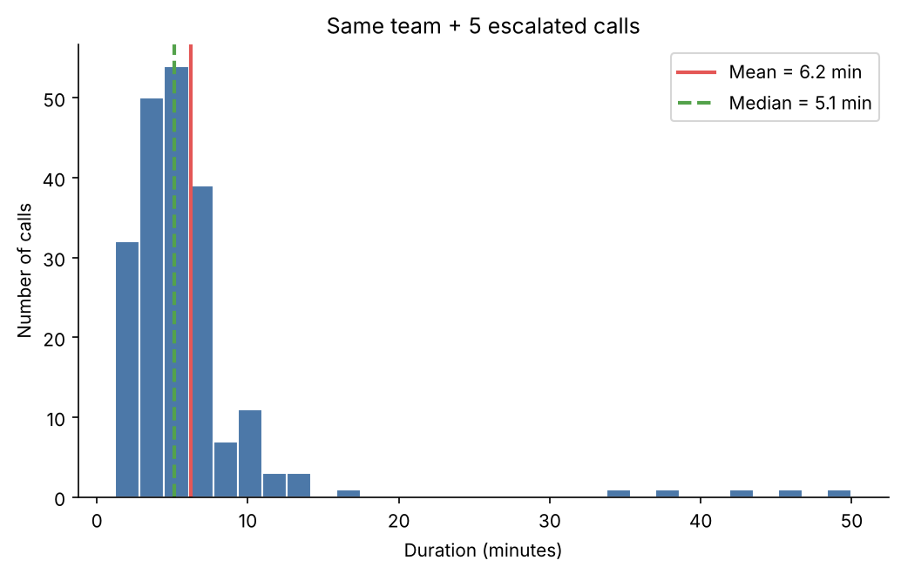
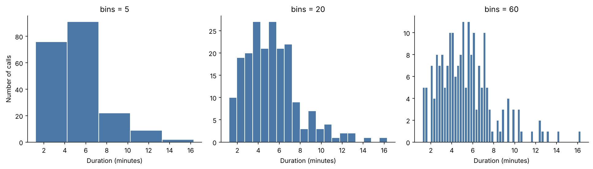

# 📞 Call Duration Analysis: When the Average Lies

A small descriptive-statistics project inspired by my experience in customer care.
It shows why **"average handling time"** can be misleading, and what to report instead.

## Business question
If a few calls are unusually long, does the average still reflect what most customers experience?

## Dataset
`calls.csv`: 200 simulated calls (seeded, reproducible)

| Field | Type |
|---|---|
| `call_id` | Nominal (ID) |
| `call_type` | Categorical (Billing, Technical, Sales, General) |
| `priority` | Ordinal (Low < Medium < High) |
| `duration_min` | Numerical (minutes) |

## Key results

| Metric | Normal day | + 5 long calls | Change |
|---|---|---|---|
| Mean | 5.3 min | 6.2 min | **+17%** |
| Median | 5.1 min | 5.1 min | **0%** |
| Std deviation | 2.6 min | 6.3 min | +142% |
| IQR | 3.0 min | 3.2 min | +7% |



**Takeaways**
- Only 5 calls (2.4% of volume) pushed the mean up by 17%, and the median did not move.
- Standard deviation is sensitive to outliers. IQR is robust.
- Histogram bin size changes the story: too few bins hide the shape, too many add noise.



## Recommendation
Report **median + IQR** as the headline KPI, and track escalated or long calls as a **separate metric**.

## Tools
Python · pandas · NumPy · matplotlib

## How to run
```bash
pip install pandas numpy matplotlib
jupyter notebook call_duration_analysis.ipynb
```
